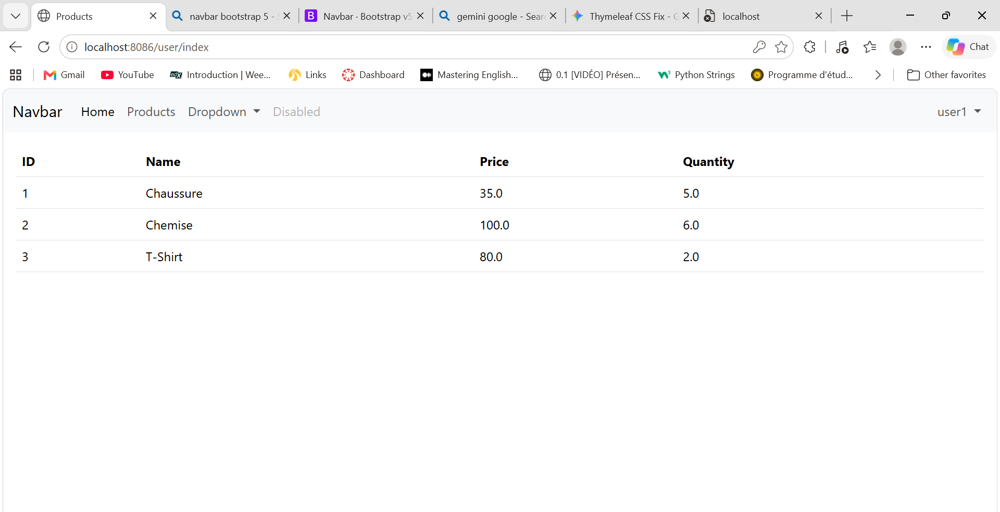
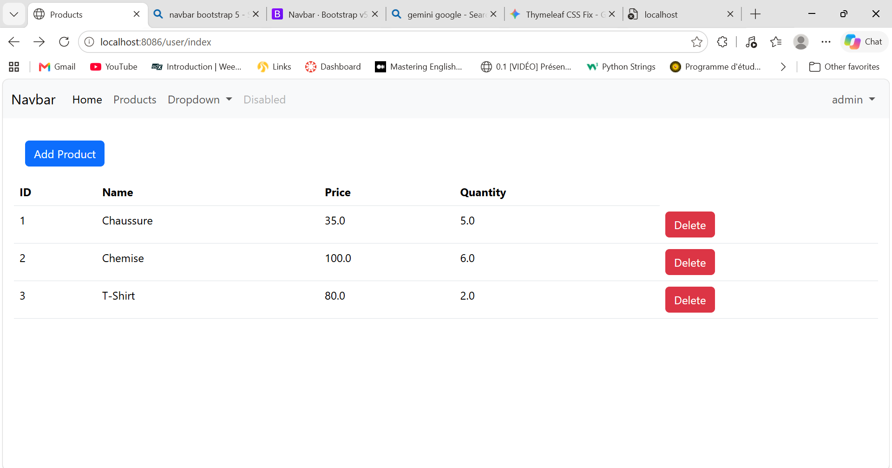
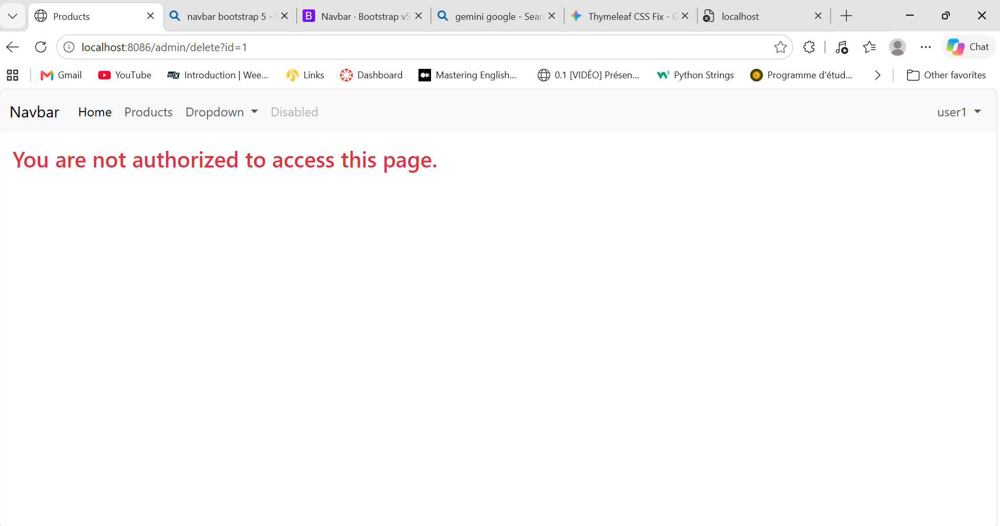

# TP : Application Web de Gestion de Produits avec Spring MVC, Thymeleaf & Spring Security

Ce projet est une application web réalisée dans le cadre d'un Travail Pratique basé sur le notre cours sur Spring MVC et tymeleaf et Boostrap

## Description du TP

L'objectif de ce TP est de développer une application web complète en utilisant l'écosystème **Spring Boot** :
- **Spring MVC & Thymeleaf** : Création des vues dynamiques côté serveur avec intégration de **Bootstrap 5** pour l'interface utilisateur.
- **Spring Data JPA** : Gestion de la persistance des données (entité `Product` avec ID, nom, prix, quantité).
- **Spring Security** : Mise en place de l'authentification (page de connexion personnalisée) et de la gestion des autorisations basées sur les rôles (`USER` et `ADMIN`).

---

## Aperçu de l'application

### 1. Authentification
L'accès à l'application est sécurisé par une page de connexion personnalisée permettant d'authentifier les utilisateurs selon leurs rôles.

---

### 2. Vue Utilisateur (`ROLE_USER`)
Lorsqu'un utilisateur standard (`user1`) se connecte, il peut consulter la liste des produits disponibles, mais les actions de création et de suppression sont masquées.

---

### 3. Vue Administrateur (`ROLE_ADMIN`)
Lorsqu'un administrateur (`admin`) se connecte, il dispose de privilèges étendus : un bouton **Add Product** apparaît ainsi que des boutons **Delete** pour chaque produit.

---

### 4. Ajout d'un nouveau produit (Réservé à l'Admin)
L'administrateur peut accéder au formulaire `/admin/newProduct` pour ajouter un nouvel article au catalogue.

---

### 5. Gestion des accès non autorisés
Si un utilisateur simple tente d'accéder directement à une URL réservée à l'administrateur (ex: `/admin/delete?id=1`), Spring Security bloque la requête et affiche une page d'erreur personnalisée.

---

## 🛠️ Technologies utilisées
- **Java / Spring Boot**
- **Spring MVC**
- **Thymeleaf** (avec Thymeleaf Layout Dialect & Spring Security Extras)
- **Spring Security**
- **Spring Data JPA / H2 (ou MySQL)**
- **Bootstrap 5**